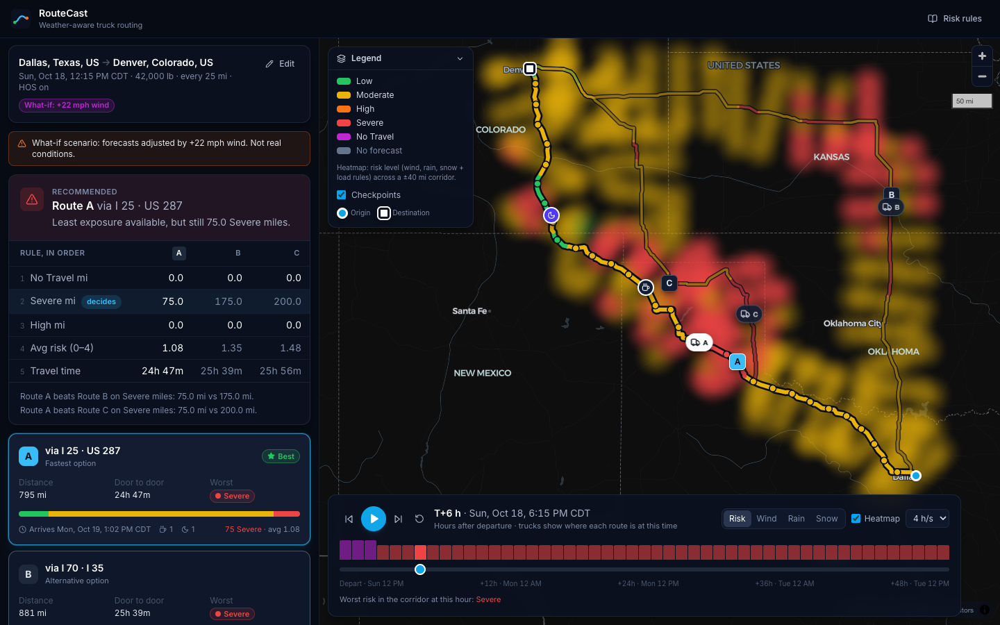
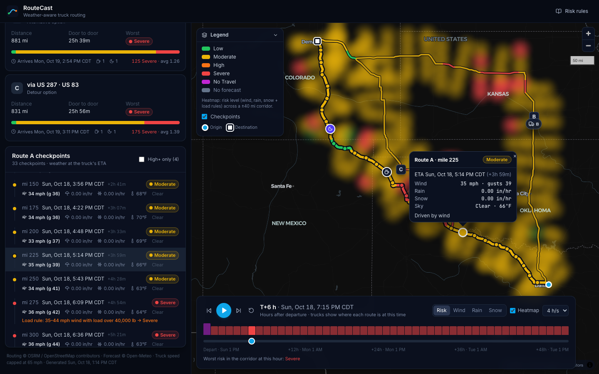
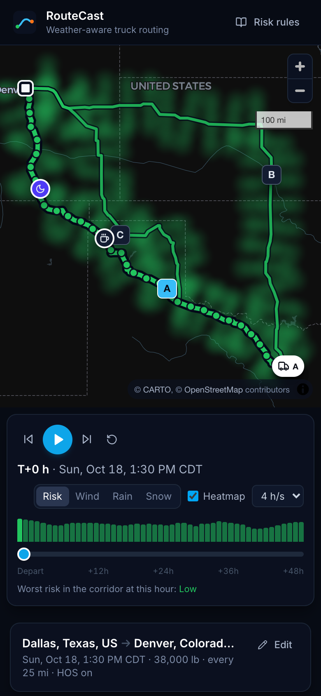

# RouteCast

Weather-aware truck routing, built for the Spotter AI full-stack assessment.

You enter a trip (origin, destination, departure time and load weight). The app finds three road routes, works out when the truck reaches each checkpoint, looks up the forecast for that hour, and scores the risk using the assessment's thresholds and load rules. It then recommends one route and shows which rule made the difference. A 48-hour corridor heatmap with a time slider shows how the weather moves along the routes, and where each truck is at that hour.

- Live app: _add the hosted URL_
- Walkthrough video: _add the Loom URL_



| Checkpoint detail at the truck's ETA | On a phone |
|---|---|
|  |  |

## What it covers

| From the brief | How I did it |
|---|---|
| Origin, destination, departure date and time, load weight | A form with place search (typing `lat, lon` also works), quick departure times and load presets. Validated in the browser and again on the server. |
| Three route options | OSRM's alternatives often stop at two, so when that happens I ask for routes through detour points on either side of the fastest one. Anything that shares 80% or more of its road with a route I already have, or is more than 50% slower, is dropped. |
| Weather every 10, 25 or 50 miles at the truck's ETA | Checkpoints are placed along the route, each ETA comes from OSRM's segment timings (with optional driver hours-of-service), and Open-Meteo's hourly forecast is read at that time. |
| Risk levels and load rules | `backend/planner/domain/risk.py`. Table driven, with a test for every boundary. |
| Recommendation: fewest Severe miles, then High miles, average risk, travel time | `backend/planner/domain/recommend.py`. It also reports which rule decided between each pair of routes. The UI shows this as a small decision table. |
| Map with routes, checkpoints, risk levels, ETAs and summaries | MapLibre GL: routes coloured by risk, checkpoint popups, break and rest stops, route cards and a checkpoint timeline. |
| Corridor heatmap with a 0 to 48 hour slider | The server computes all 49 hourly frames for a band about 40 miles either side of the routes. The slider only changes values already on the map, so scrubbing and playback stay smooth. |

## How a plan is put together

1. OSRM returns the routes, with a duration for every segment.
2. Segments faster than 65 mph are slowed to that speed. The public OSRM server only has a car profile, and trucks don't run at car speeds.
3. With hours of service on (the default), a 30-minute break is added after 8 hours of driving and a 10-hour reset after 11. Without this, any trip longer than a day would be checked against the wrong hour's weather.
4. Checkpoints go at mile 0, every N miles, and at the destination. Each one gets a driving time and a clock time.
5. Weather comes from Open-Meteo, one hourly series per 0.1° grid cell (about 7 miles). Routes that overlap share cells, and so does the heatmap, so each cell is downloaded once. Requests go out 50 locations at a time and are cached for 30 minutes. Open-Meteo's free tier allows 600 locations a minute, so a plan uses at most 250 and its heatmap at most 200. Very long trips (Los Angeles to New York, say) get a coarser grid to stay inside that budget; every checkpoint is still read at its own ETA. The grid is chosen from the roads rather than the checkpoint interval, so switching between 10, 25 and 50 miles reuses the cached forecasts.
6. Each checkpoint gets a risk level, the routes are summarised by miles per level and ranked, and the result comes back with an explanation.

The heatmap is a separate request (`GET /api/plans/<id>/heatmap`), so routes show up as soon as they are scored and the corridor fills in a second later.

## How I read the rules

The thresholds are implemented as written. A few points needed a decision, and I've applied the same reading in the code, the tests, the map legend and the in-app "Risk rules" dialog.

- **Band edges.** The ranges touch (wind 25–34, then 35–44), so each band starts at its lower number: 25 mph is Moderate, 35 is High, 45 is Severe, and 55 or more is No Travel. Rain and snow write No Travel as strictly "> 1.00" and "> 3.0", so exactly 1.00 in/hr of rain is still Severe.
- **Load rules** only ever make things worse. 55 mph or more is No Travel whatever the load. 45–54 mph with more than 30,000 lb is No Travel. 35–44 mph with more than 40,000 lb is Severe. When a load rule changes the level, the checkpoint says so.
- **A checkpoint's level** is the worst of its wind, rain and snow levels. Wind means the sustained 10 m wind; gusts are shown but not scored.
- **Miles per level.** Each checkpoint covers the road halfway to the checkpoints on either side, so the miles always add up to the route length.
- **Average risk** is weighted by distance, with Low = 0 up to No Travel = 4.
- **Ranking** follows the brief's order, with one rule added in front: fewest No Travel miles. A route you can't legally or safely drive shouldn't win because it has fewer Severe miles. Miles are compared to 0.1 mi so rounding noise never decides.
- **Forecast at an ETA.** Wind is interpolated between hours. Open-Meteo reports rain, showers and snowfall as totals for the hour before each timestamp, which is already a rate in in/hr. A truck at 13:20 gets the 13:00–14:00 value.
- **Heatmap colours** use the same thresholds as the checkpoints. A heatmap cell and a checkpoint with the same weather always show the same colour.
- **The slider** counts hours from departure (T+0 to T+48), which is the window when the truck is on the road.

## A few extras

- **Best time to leave.** For the same trip, the app also scores departures 3, 6, 12 and 24 hours later, using forecasts it has already downloaded. If one of them is safer, it says so ("Leaving 12 h later is safer: Route B cuts Severe miles from 125.0 mi to 0.0 mi") and one click plans that departure.
- **Shareable links.** The address bar always holds the current trip (`?o=…&d=…&t=…&w=…`), and "Copy link" puts it on the clipboard. Opening the link plans the same trip straight away. If its departure has passed by then, the trip leaves at the next quarter hour and the page says so.
- **What-if weather.** Real forecasts are often calm, which makes it hard to see the rules working. The form has a What-if section that adds wind and scales precipitation on top of the real forecast. Results built this way carry a "What-if" badge and a warning, and the default is always the real forecast.
- **Readable errors.** Every API error has the same shape, `{"error": {"code", "message", "fields"?}}`, and the message is a complete sentence that can go straight into the UI. Field errors appear next to the field. A Retry button only appears when retrying can help (network problems, rate limits, provider outages). If the weather service is busy while the heatmap loads, the app waits for the rate-limit window and retries by itself.
- **Keyboard.** The place search is a proper ARIA combobox. Space plays or pauses the forecast, and the arrow keys step one hour.

## API

| Method | Path | What it does |
|---|---|---|
| `POST` | `/api/plan` | Builds a plan |
| `GET` | `/api/plans/<plan_id>/heatmap` | 49 hourly frames of risk, wind, rain and snow for the corridor |
| `GET` | `/api/geocode?q=` | Place search (Photon, with Nominatim as fallback). Accepts `lat, lon`. |
| `GET` | `/api/meta` | Thresholds, load rules and limits |
| `GET` | `/api/health` | Health check |

```bash
curl -X POST http://localhost:8000/api/plan -H 'Content-Type: application/json' -d '{
  "origin": "Dallas, TX",
  "destination": {"lat": 39.7392, "lon": -104.9903, "label": "Denver, CO"},
  "departure": "2026-10-20T14:00:00Z",
  "load_lb": 42000,
  "interval_mi": 25,
  "hos": true
}'
```

A place can be free text or an object with `lat` and `lon`. `scenario` is optional, for example `{"wind_add_mph": 15, "precip_factor": 1}`. Departure must be between one hour ago and seven days ahead, load between 0 and 80,000 lb, and the interval 10, 25 or 50.

The response has the three routes (geometry, risk-coloured segments, checkpoints with ETA, weather and assessment, HOS stops, a 15-minute position track, and a summary), the recommendation, the departure-time advice, and any warnings. The full contract is typed in [`frontend/src/api/types.ts`](frontend/src/api/types.ts).

## Running it

You need Python 3.12+ and Node 20+. No API keys.

```bash
# API on http://127.0.0.1:8000
python3 -m venv .venv && source .venv/bin/activate
pip install -r backend/requirements-dev.txt
cd backend && python manage.py runserver

# UI on http://localhost:5173 (proxies /api to Django)
cd frontend && npm ci && npm run dev
```

## Tests

```bash
cd backend && pytest                    # 163 tests
cd frontend && npm test                 # 53 unit and component tests
cd frontend && npm run build && npm run e2e   # 45 end-to-end tests in Chromium
```

- **Backend:** every threshold edge and load rule, the heatmap score against the levels, geometry, checkpoint spacing, the HOS schedule and its inverse, ranking and tie-breaks, the three-route guarantee, forecast interpolation and batching, and the API end to end against fake OSRM and Open-Meteo responses.
- **Frontend unit tests:** formatting, the thresholds as the UI applies them, truck positions, form validation, keyboard autocomplete, the decision table, route cards, the timeline, the slider, and the app as a whole with a mocked network.
- **End to end** (Playwright): the real Django server and the production bundle in Chromium, against a small offline stand-in for OSRM, Open-Meteo and Photon (`backend/planner/tests/fake_server.py`). It places a storm on the direct Dallas–Denver route, so the results are known in advance. The tests click every control: example trips, swap, clear, autocomplete, departure and load shortcuts, interval, HOS, what-if, route selection from cards, table and map, checkpoint popups from the timeline and the map, the legend, zoom, playback, metric switching, the hourly strip, keyboard shortcuts, the rules dialog, the departure-time advice and shareable links. They also cover error cases (no road route, network down, provider outage, a busy weather service, server field errors, expired plan) and a phone layout.

GitHub Actions runs lint, formatting, type checks, all three suites and a production build on every push.

## Deploying

It runs as one Docker service: Django serves the API and the built React app through WhiteNoise. The files are pre-compressed, and hashed assets are cached for a year.

```bash
docker build -t routecast .
docker run -p 8000:8000 -e DJANGO_SECRET_KEY=change-me -e DJANGO_ALLOWED_HOSTS=localhost routecast
```

`render.yaml` deploys it on Render as it is, on the free plan. Gunicorn runs a single process with eight threads on purpose. Plans are cached in memory, and the heatmap request has to reach the same process. Moving the cache to Redis would remove that limit.

Free Render services sleep after 15 idle minutes. The `Keep the demo awake` workflow pings `/api/health` every five minutes once the repository variable `APP_URL` is set.

## Layout

```
backend/
  config/             settings, urls, wsgi
  planner/
    domain/           the rules: risk, recommend, sampling, hos, geo (no I/O)
    services/         routing, weather, geocoding, corridor heatmap, plan assembly
    serializers.py    request validation
    views.py          HTTP layer and the shared error handler
    tests/            pytest suite, fake providers, offline provider server for E2E
frontend/
  src/api/            typed client and response types
  src/components/     form, place search, recommendation, cards, timeline, slider, legend, map
  src/lib/            formatting, risk colours and thresholds, truck position maths
  e2e/                Playwright tests
```

## Known limits

- Routing uses OSRM's car profile with a speed cap, so truck restrictions such as low bridges or weight limits are not considered. A heavy-goods profile (OpenRouteService `driving-hgv`, or a self-hosted OSRM truck profile) would plug into `services/routing.py`.
- Forecast detail is whatever Open-Meteo's models provide, roughly 3 to 13 km.
- Fuel stops, inspections and the 14-hour duty window are not modelled. With continuous driving the 11-hour limit always applies first.
- OSRM, Photon and Open-Meteo are free public services with fair-use limits. Heavy use would need self-hosting or paid plans.

## Credits

Routing by [OSRM](https://project-osrm.org/) on OpenStreetMap data. Forecasts from [Open-Meteo](https://open-meteo.com/) (CC BY 4.0). Geocoding by [Photon](https://photon.komoot.io/) and Nominatim. Basemap © CARTO and OpenStreetMap contributors. Maps drawn with [MapLibre GL JS](https://maplibre.org/).
